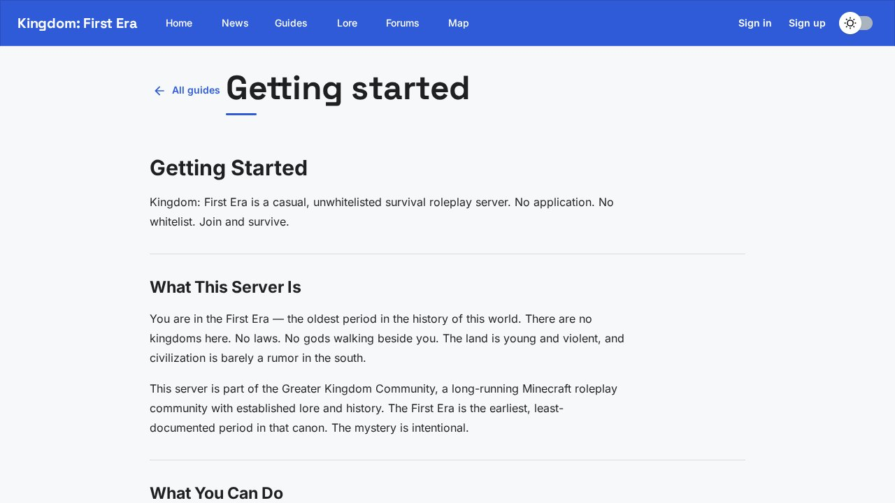
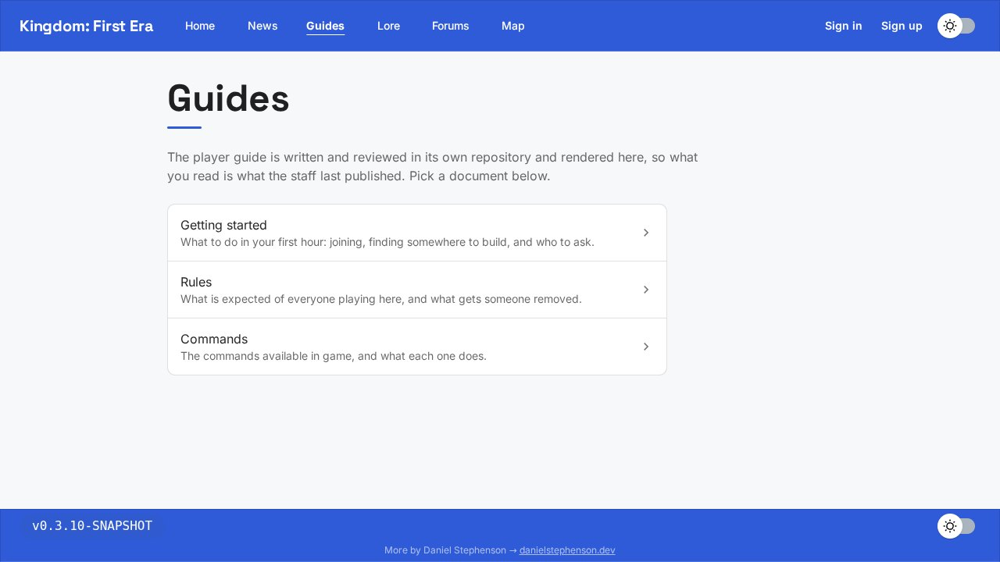
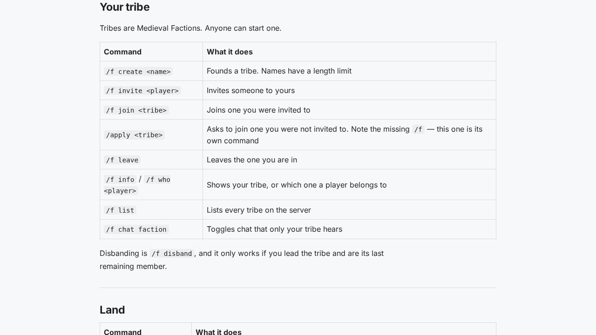
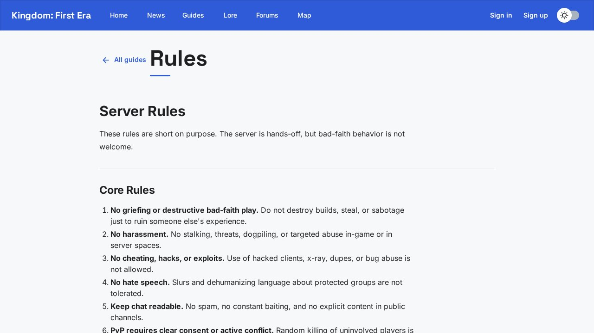
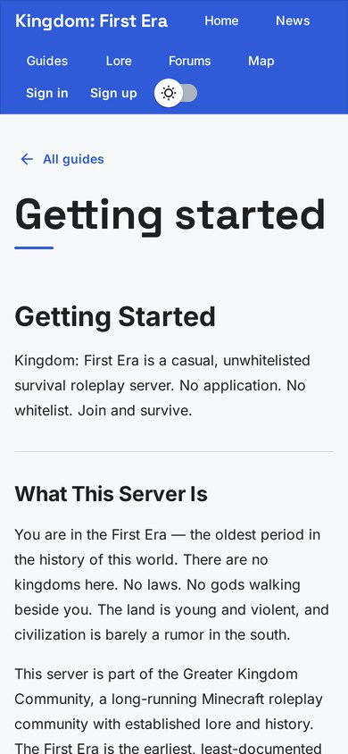
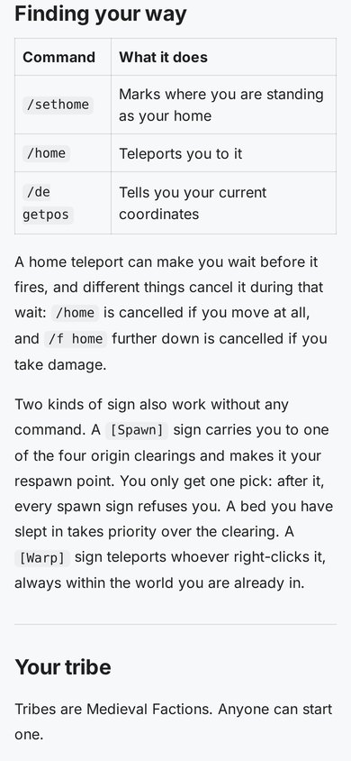

# Kingdom: First Era — Player Guide

**Kingdom: First Era** is a casual, unwhitelisted survival roleplay Minecraft
server set in the earliest age of the Greater Kingdom Community's world. No
application. No whitelist. Join and survive.

You are among the first peoples. There are no kingdoms yet, no laws, no gods
walking beside you. Form a tribe or survive alone. Tame the wild or be consumed
by it.

*These guides as players read them on [kingdomfirstera.com](https://kingdomfirstera.com/guides).*

---

> ## The beta ends 30 September
>
> This run is a beta. It opens **Tuesday 1 September 2026** and ends on
> **Wednesday 30 September 2026**. When it ends, the world is backed up and
> then **wiped** — builds, items, tribes, and progress do not carry over.
>
> Nothing is hidden about this: build something enormous or build nothing at
> all, but decide knowing the era has thirty days in it.

---

## How to Join

There is nothing to apply for. The server has no whitelist and no ranks to earn.

**Address: `play.kingdomfirstera.com`**

Add that to your Minecraft server list, pick one of the four origins at a
`[Spawn]` sign, and you are in.

The address is a name rather than a number on purpose: if the server is ever
rebuilt or moved, the entry saved in your client keeps working.

The community site at <https://kingdomfirstera.com> carries the same guides,
live server status, and the published lore.

Read [`getting-started.md`](getting-started.md) before your first session, and
keep [`commands.md`](commands.md) open next to you for the first few.

---

## The Guides

| Page | What it covers |
|---|---|
| [`getting-started.md`](getting-started.md) | What the server is, what you can do, and what to expect from staff |
| [`commands.md`](commands.md) | The commands you need on your first day — tribes, land, chat, mail, pets, skills |
| [`rules.md`](rules.md) | The server rules, in full. They are short |

---

## What to Expect

- **The server is hands-off by design.** There is no preset storyline, no
  scheduled events, and no staff-driven narrative. What players build, destroy,
  or remember becomes the history of the era.
- **Origins, not factions handed to you.** Everyone starts from one of four
  origins — North, South, East, or West. Each has a place to start and an old,
  unreliable account of how people came to be there. Who your people are is
  yours to decide.
- **Tribes, not kingdoms.** Players who organize are forming the earliest
  tribal bands, not political states.
- **Emergent lore.** The mystery of the First Era is intentional. Gaps are
  features, not failures.
- **The era ends.** The beta runs to 30 September 2026, after which the world
  is archived and wiped. What survives an era was never the buildings.

---

## Screenshots

The site renders these Markdown files straight from this repository's default
branch, so a merged change here is what players see.

| Guide index | Commands |
|---|---|
|  |  |
| The guide index, listing the three documents in this repository | [`commands.md`](commands.md): the tribe commands table |

*[`rules.md`](rules.md), the seven core rules, as rendered on the site.*

On a phone (390x844):

  
  

**Regenerating screenshots:** with a copy of the community site running locally,
`darkroom shoot docs/screenshots/media.json --var base=http://localhost:3000 --force`
(shot list: [`docs/screenshots/media.json`](docs/screenshots/media.json), tool:
[darkroom](https://github.com/Preponderous-Software/darkroom)).

---

## License

Licensed under the **Stephenson Software Non-Commercial License
(Stephenson-NC)** — see [`LICENSE.md`](LICENSE.md).

---

*What you build here will be forgotten, or it will become legend.*
